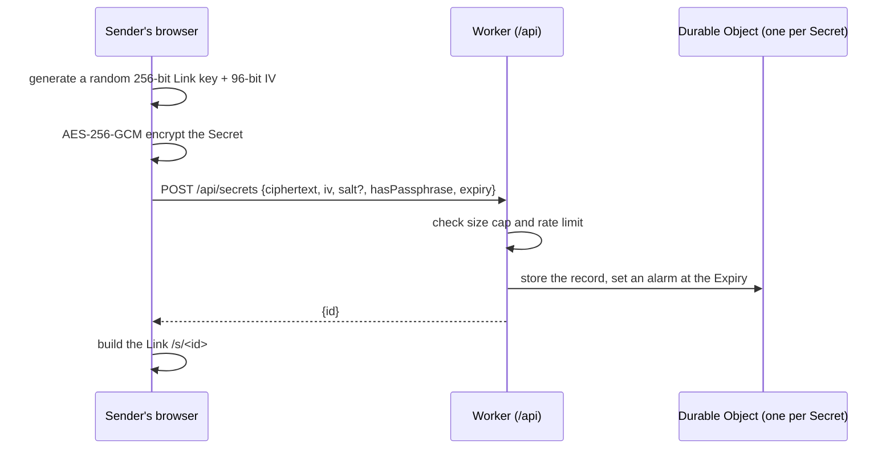
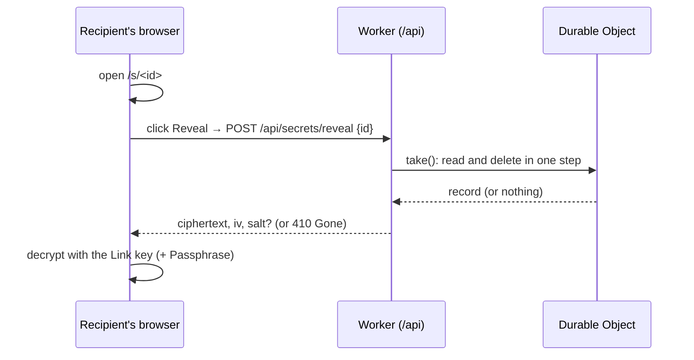

# secret

**[secret.tonytang.dev](https://secret.tonytang.dev)**: send a password, API key or any short Secret through a Link that works once and is then gone. The Secret is encrypted in your browser, so the server never sees it.

No accounts and no sign-up. Paste up to 10 KB of text, pick an Expiry (1 hour, 1 day or 7 days), optionally add a Passphrase, and share the Link.

[](https://github.com/sponsors/tonytangdev)

If this is useful to you, you can **[sponsor me on GitHub](https://github.com/sponsors/tonytangdev)**. It helps me keep building small tools like this one.

## How it works

Short version: _encrypted in your browser → the key never leaves the Link → deleted after one read._

### 1. Sending



1. Your browser generates a random 256-bit **Link key** and encrypts the Secret with AES-256-GCM through WebCrypto ([`src/shared/crypto.ts`](src/shared/crypto.ts)).
2. It sends only the ciphertext, IV, optional salt, a has-passphrase flag and the Expiry. The server picks a random 128-bit ID and stores the record.
3. The Link looks like `https://secret.tonytang.dev/s/<id>#<link-key>`. The Link key sits after the `#`, in the URL fragment, and **browsers never send the fragment to a server**. The server holds ciphertext it has no key for ([ADR-0001](docs/adr/0001-zero-knowledge-key-in-url-fragment.md)).

### 2. With a Passphrase (optional)

A leaked Link on its own is enough to read the Secret. To guard against that, add a Passphrase and share it through another channel (a call, a different app).

With a Passphrase, the AES key is no longer the Link key itself. It becomes:

```
HKDF-SHA256( Link key ‖ PBKDF2-SHA256(Passphrase, salt, 600,000 iterations) )
```

so the recipient needs both the Link and the Passphrase. The Link ends in `.p` (`#<link-key>.p`) so the page knows to ask for a Passphrase without asking the server.

### 3. Receiving: Reveal, then Burn



- **Opening the Link does nothing.** Link-preview bots (Slack, iMessage, Teams…) fetch Links as soon as they're pasted, so the page waits for you to click **Reveal** ([ADR-0007](docs/adr/0007-reveal-step-and-in-tab-passphrase-retry.md)).
- **Reveal Burns the Secret.** Each Secret lives in its own Cloudflare Durable Object, which handles one request at a time. `take()` reads and deletes the record with no `await` in between, so even if two requests arrive together, only one gets the Secret ([ADR-0002](docs/adr/0002-durable-objects-for-atomic-take.md), [`src/worker/durable-object.ts`](src/worker/durable-object.ts)).
- **Wrong Passphrase?** The ciphertext stays in that tab's memory, so you can try again without a new Link. This gives an attacker nothing they couldn't already get: anyone with the Link could download the ciphertext and guess offline, which is what PBKDF2's 600,000 iterations make slow.
- After Reveal, the Secret is hidden until you click show, and it exists only in that tab.
- **Gone** means "doesn't exist, already revealed or expired". The server gives the same answer for all three, so none can be told apart. If you didn't open it yourself, tell the sender: someone else may have.

### 4. Expiry

An unrevealed Secret Burns at its Expiry: the Durable Object's alarm deletes it. Until the alarm fires, a Reveal past the Expiry is treated as gone.

## What's protected, and what isn't

**Protected**

- The server (and anyone who gets into it) only ever sees ciphertext.
- A Secret can be revealed once, even under concurrent requests.
- Expired Secrets are deleted.
- **No third-party code runs on the page.** Any script on the page could read the Link key from `location.href`, so there are no analytics, trackers or CDNs. A strict CSP (`default-src 'self'`, no inline scripts, `frame-ancestors 'none'`) enforces it, fonts are self-hosted, and `Referrer-Policy: no-referrer` keeps the Link from leaking when you click away ([ADR-0005](docs/adr/0005-no-third-party-javascript.md)).
- **No logs.** Worker logs and traces are off. Reveal sends the Secret ID in the request body, never in the URL. The only stored usage data is a count of Secrets created, revealed and expired.

**Not protected**

- A compromised device, browser or extension on either end.
- A leaked Link without a Passphrase: whoever opens it first gets the Secret.
- A recipient who copies the Secret somewhere else.
- The code the server sends you. The encryption runs in JavaScript served by this site, so you're trusting that it matches this repo. That's why the source is public.

**Abuse limits:** 20 Secrets per hour per client, and 10 KB per Secret (checked in the browser, then again on the server). Clients are counted by an HMAC of their IP, never the raw IP, and the count is deleted when the hour ends.

There's a longer, plain-language version at [secret.tonytang.dev/how-it-works](https://secret.tonytang.dev/how-it-works).

## Architecture

Everything is a single Cloudflare Worker:

- Static assets (the Preact app) are served directly, with an SPA fallback.
- `/api/*` goes to the Worker, which implements an [Effect](https://effect.website) `HttpApi` contract.
- One `SecretObject` Durable Object per Secret (atomic read-and-delete, alarm for Expiry), plus one `CreateQuota` Durable Object per client for the rate limit.
- Workers Analytics Engine stores the usage counts.

```
src/
  shared/   API contract + schemas, crypto, Link format, limits. Used by both sides.
  worker/   The Cloudflare Worker: API handlers, Durable Objects, rate limit.
  web/      The browser app: Vite + Preact + preact-iso + Tailwind v4.
tools/      Node scripts and a local oxlint plugin.
docs/adr/   Decisions and their trade-offs.
```

The browser uses a typed client derived from the same contract the Worker implements, so both sides agree on every request and error. Words like Secret, Link, Link key, Passphrase, Reveal, Burn and Expiry have exact meanings, defined in [GLOSSARY.md](GLOSSARY.md). The product scope is in [PRODUCT.md](PRODUCT.md).

## Running it locally

Requires the Node version in [`.nvmrc`](.nvmrc).

```sh
npm install
cp .dev.vars.example .dev.vars   # local IP_HASH_KEY for the rate limit
npm run dev                      # Vite + the Worker in workerd
```

| Command           | What it does                                                            |
| ----------------- | ----------------------------------------------------------------------- |
| `npm run dev`     | Dev server with the Worker running in workerd                           |
| `npm run build`   | Production build (`dist/client`, `dist/secret`)                         |
| `npm run preview` | Serves the production build in workerd                                  |
| `npm test`        | Builds, then runs the tests (Node + real Durable Objects in workerd)    |
| `npm run check`   | Typecheck, lint, format check, tests and dead-code check (what CI runs) |

Each security promise has a test behind it: crypto round trips (with and without a Passphrase, wrong Passphrase fails), read-once under concurrent requests, Expiry, the size cap and the rate limit.

Merges to `main` deploy to production through CI. Contributor and agent rules are in [AGENTS.md](AGENTS.md).

## Contributing

Issues are welcome. Outside pull requests need a signed CLA first, so the project can stay relicensable ([ADR-0006](docs/adr/0006-agpl-license.md)).

## Support

If you use this or just like it, [sponsoring me on GitHub](https://github.com/sponsors/tonytangdev) is the best way to say thanks. ❤️

## License

[AGPL-3.0](LICENSE). If you run a modified version as a service, you have to publish your source.
